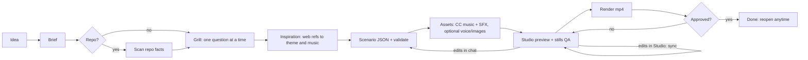

# Christopher Nolan

**Your coding agent directs the video. You make the decisions.**

Christopher Nolan is a video studio driven by your AI coding agent, built on [Remotion](https://www.remotion.dev). Say "make a trailer of my repo". The agent reads your code and interviews you about the video one question at a time. Then it writes the scenario, fetches free music and sound effects with licenses cleared and credited, and opens a live preview you can tweak in the browser. It renders the final mp4 once you approve.

It works with Claude Code, Codex, Cursor, Gemini CLI, OpenCode, GitHub Copilot, and any agent that can run a shell command. **No API key is needed.** Your agent does the thinking. An optional OpenRouter key adds a voice-over, AI images and a second-opinion critique, capped by a hard budget.

## Quick start (60 seconds)

**Claude Code** (plugin marketplace):

```
/plugin marketplace add Zokuzo/christopher-nolan
/plugin install christopher-nolan@christopher-nolan
```

**Codex, Cursor, Gemini CLI, OpenCode, Copilot, Claude Code** ([skills](https://github.com/vercel-labs/skills) installer):

```bash
npx skills add Zokuzo/christopher-nolan        # project scope
npx skills add Zokuzo/christopher-nolan -g     # all your projects
```

**Manual** (any agent):

```bash
git clone https://github.com/Zokuzo/christopher-nolan ~/.christopher-nolan
cd ~/.christopher-nolan && npm install && node cli/nolan.ts setup
mkdir -p ~/.agents/skills && ln -s ~/.christopher-nolan/skills/nolan ~/.agents/skills/nolan
# Claude Code reads ~/.claude/skills: ln -s ~/.christopher-nolan/skills/nolan ~/.claude/skills/nolan
```

Then ask your agent:

> Make a 45-second trailer of this repo.

The first run installs the studio into `~/.christopher-nolan` (it asks first; about 2 minutes, including headless Chrome). Set `NOLAN_HOME` to use another location. In Claude Code you can also type `/nolan` (or `/christopher-nolan:nolan` as a plugin); in Codex, mention `$nolan`.

**Requirements:** Node 22.18+, git. Chrome is installed automatically by Remotion. ffmpeg is optional; Remotion's bundled copy is used when it is missing.

## How it works



Every step is saved in `projects/<slug>/`, so you can stop at any point and come back later. The agent always starts with `nolan status`, which prints the current stage and the exact next step.

## Features

- **Grilling, not guessing.** The agent maps the video as a design tree: audience, format, hook, story arc, what to show, theme, music, SFX, voice and CTA. It asks one question at a time and gives a recommended answer, so you can reply "ok". It looks up facts itself and never asks you what your code does. It builds nothing until you confirm the summary.
- **12 scene types:** title, kinetic text, code (Shiki-highlighted, typing, line focus), file tree, architecture diagram, terminal, animated stats, bullets, quote, image (Ken Burns), before/after compare, and an outro with auto-generated credits.
- **6 theme presets:** `interstellar` (default: cinematic amber on black), `neon-terminal`, `editorial-light`, `brutalist`, `retro-crt`, `clean-dark`. Each sets the palette, Google Fonts, spring physics, transitions, grain and music moods. Any token can be overridden.
- **16:9, 9:16 and 1:1** from the same scenario.
- **Live preview in Remotion Studio.** Every field of the scenario is editable in the Props panel. Save with 💾 and your agent syncs it back with version history. Studio is reachable from your local network while it runs: use it on trusted networks and stop it when done (`nolan studio <slug> --stop`).
- **Self-QA.** The agent renders stills and looks at them itself to catch clipped text and broken layouts before you see them.
- **Free audio with credits.** Music comes from Openverse (Jamendo, Wikimedia, Freesound), then ccMixter, then a bundled bed. SFX are vendored from `@remotion/sfx`. Auto cues cover whooshes on cuts, impacts on titles, risers, typing clicks and dings on stats. The music ducks under the voice, and fades and loudness normalization are applied automatically.
- **Versions:** snapshot, list, restore, reopen an approved video.
- **Agent-agnostic:** one [Agent Skills](https://agentskills.io) skill and one plain Node CLI (`node cli/nolan.ts`) with no build step and agent-readable output.

## OpenRouter (optional) and budget

With an [OpenRouter](https://openrouter.ai) key you get:

| Feature | Command | Default model | Typical cost |
|---|---|---|---|
| Voice-over | `nolan ai tts <slug>` | `google/gemini-3.8-flash-lite-tts` | cents per video |
| AI image | `nolan ai image <slug> <scene> --prompt ...` | `recraft/recraft-v4.1-flash` | ~$0.007 / image |
| Scenario critique by a second model | `nolan ai critique <slug>` | `openai/gpt-5.6-luna` | ~$0.01 |
| AI music (experimental) | `nolan ai music <slug>` | `google/lyria-3-clip-preview` | ~$0.04 / clip |

Setup:

```bash
node cli/nolan.ts config set-key          # paste the key; stored in ~/.config/christopher-nolan/.env (chmod 600)
node cli/nolan.ts ai status               # key, budget, spent, remaining
node cli/nolan.ts config set budgetUsd 5  # default hard cap: $2.00
```

Every call reserves an estimate first. A call is refused if it would push spending past the cap, and it is settled at the real cost afterwards (ledger: `~/.config/christopher-nolan/ledger.jsonl`). The agent announces the cost and waits for your yes before any paid call. For a server-side backstop, create a dedicated OpenRouter key with its own credit limit. Model IDs are configurable (`nolan config set ttsModel ...`).

## Audio licensing

- Only **CC0**, **public domain** and **CC BY** audio is accepted by default. **CC BY-SA** is opt-in, because it requires the video to be shared under the same license. **NonCommercial and NoDerivatives licenses are always rejected.**
- Every downloaded file is recorded in `public/projects/<slug>/assets.lock.json` with its title, creator, license and source. The outro scrolls these credits automatically and `render` prints them. Keep them in your video description too. CC BY requires attribution.
- The `@remotion/sfx` sounds need no attribution.
- AI music follows the model provider's terms and is watermarked (SynthID).

## Remotion license

Christopher Nolan is MIT-licensed, but it renders with **Remotion**, which has its own license. Remotion is free for individuals, non-profits and companies with up to 3 employees. **Companies with more than 3 employees need a Remotion company license** to use it, and that includes using it through this tool. See [remotion.dev/license](https://www.remotion.dev/license).

## CLI reference

`node cli/nolan.ts help` lists every command. The main ones:

```
status [slug]            where every project is + the next command
new <slug>               create a project (--title, --repo, --format)
scan <slug> [PATH]       repo facts for the agent
validate <slug>          schema, timing, reading-time warnings
audio all <slug>         music + sfx, licensed and credited
studio <slug>            live preview (http://localhost:3123)
sync <slug>              pull Studio edits into scenario.json
stills <slug>            PNG frames for visual QA
render <slug> [--draft]  mp4 + thumbnail
approve | reopen <slug>  lock or unlock the final version
```

Try the included demo, a trailer of this repo (its music and credits are committed; it is approved, so leave its assets alone):

```bash
node cli/nolan.ts studio christopher-nolan-trailer
```

## Contributing

See [AGENTS.md](AGENTS.md) (commands, layout, rules) and [docs/SPEC.md](docs/SPEC.md).

## Credits

- [Remotion](https://www.remotion.dev) for the rendering engine, Studio, transitions, Google Fonts and SFX.
- The grilling method is adapted from [mattpocock/skills](https://github.com/mattpocock/skills) (MIT). If you have Matt Pocock's `grilling` skill installed, the agent uses it.
- [Openverse](https://openverse.org), [ccMixter](https://ccmixter.org) and every artist who licenses their work openly.
- [Shiki](https://shiki.style) for code highlighting.
- Optional companion: `npx skills add remotion-dev/skills` for Remotion best practices.

Third-party notices: [THIRD_PARTY_NOTICES.md](THIRD_PARTY_NOTICES.md). License: [MIT](LICENSE) © 2026 Zokuzo.
